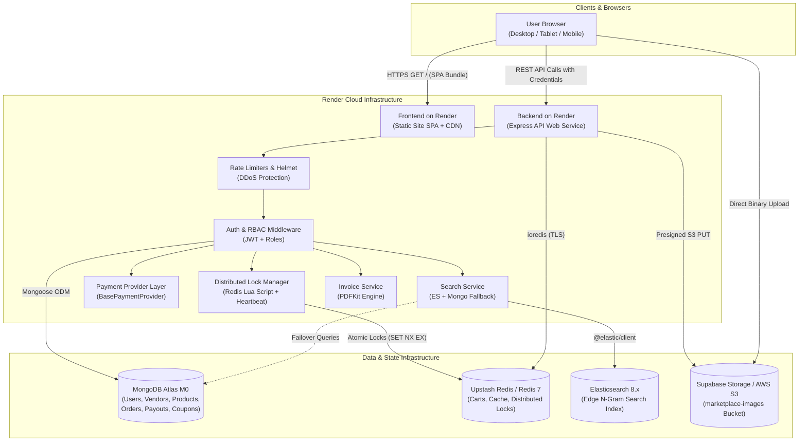
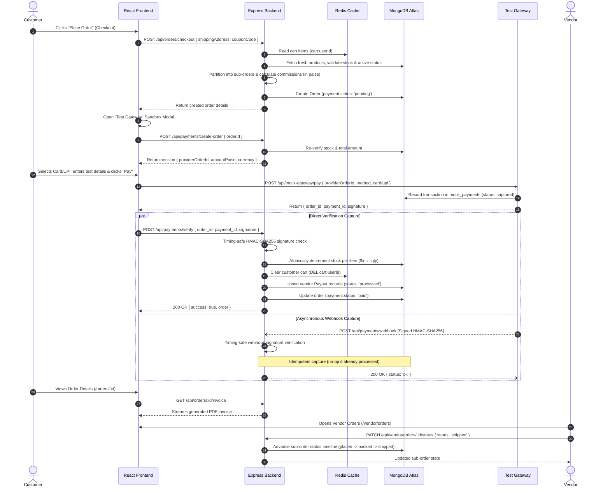

# ShopNest – Multi-Vendor E-Commerce Marketplace

[](https://nodejs.org/)
[](https://expressjs.com/)
[](https://react.dev/)
[](https://vitejs.dev/)
[](https://www.mongodb.com/)
[](https://redis.io/)
[](https://www.elastic.co/)
[](https://aws.amazon.com/s3/)
[](#16-author-and-license)

**GitHub Repository:** [https://github.com/Itachi210-cmd/Multi-Vendor-E-Commerce-Marketplace](https://github.com/Itachi210-cmd/Multi-Vendor-E-Commerce-Marketplace)

---

## Table of Contents

1. [Project Overview](#1-project-overview)
2. [Key Features](#2-key-features)
   - [Customer Experience](#customer-experience)
   - [Vendor Studio & Operations](#vendor-studio--operations)
   - [Platform Administration](#platform-administration)
   - [Authentication & Authorization](#authentication--authorization)
   - [Product Catalog Management](#product-catalog-management)
   - [Shopping Cart & Checkout](#shopping-cart--checkout)
   - [Orders & Split Payments](#orders--split-payments)
   - [Search & Faceted Filtering](#search--faceted-filtering)
   - [Direct-to-Cloud Image Uploads](#direct-to-cloud-image-uploads)
3. [Technology Stack](#3-technology-stack)
4. [Project Architecture](#4-project-architecture)
   - [Architecture Diagram](#system-architecture-diagram)
   - [End-to-End Order & Split Payment Lifecycle](#end-to-end-order--split-payment-lifecycle)
5. [Project Folder Structure](#5-project-folder-structure)
6. [Screenshots](#6-screenshots)
7. [Installation and Local Setup](#7-installation-and-local-setup)
   - [Prerequisites](#prerequisites)
   - [Step 1: Clone Repository](#step-1-clone-repository)
   - [Step 2: Backend Setup](#step-2-backend-setup)
   - [Step 3: Frontend Setup](#step-3-frontend-setup)
   - [Step 4: Launching Dev Services & Database](#step-4-launching-dev-services--database)
   - [Step 5: Database Seeding & Search Indexing](#step-5-database-seeding--search-indexing)
   - [Step 6: Running the Application](#step-6-running-the-application)
   - [Running Backend Automated Tests](#running-backend-automated-tests)
8. [Environment Variables](#8-environment-variables)
   - [Backend Configuration (`backend/.env`)](#backend-configuration-backendenv)
   - [Frontend Configuration (`frontend/.env`)](#frontend-configuration-frontendenv)
9. [API Documentation](#9-api-documentation)
10. [User Roles and Permissions](#10-user-roles-and-permissions)
11. [Database and Integrations](#11-database-and-integrations)
    - [MongoDB Atlas (Mongoose ODM)](#mongodb-atlas-mongoose-odm)
    - [Redis & Upstash Cache](#redis--upstash-cache)
    - [Elasticsearch with MongoDB Fallback](#elasticsearch-with-mongodb-fallback)
    - [Object Storage (AWS S3 / Supabase / MinIO)](#object-storage-aws-s3--supabase--minio)
12. [Payment Integration & Test Gateway](#12-payment-integration--test-gateway)
    - [Provider-Neutral Architecture](#provider-neutral-architecture)
    - [Interactive Test Gateway Modal](#interactive-test-gateway-modal)
    - [Commission Calculation & Vendor Payout Math](#commission-calculation--vendor-payout-math)
    - [Distributed Concurrency Locks on Payment Orders](#distributed-concurrency-locks-on-payment-orders)
    - [Cryptographic Webhook Processing](#cryptographic-webhook-processing)
    - [Cancellation & Refund Mechanics](#cancellation--refund-mechanics)
13. [Deployment](#13-deployment)
    - [Backend Deployment on Render](#backend-deployment-on-render)
    - [Frontend Deployment on Render](#frontend-deployment-on-render)
    - [Post-Deployment Verification Checklist](#post-deployment-verification-checklist)
14. [Security](#14-security)
15. [Future Improvements](#15-future-improvements)
16. [Author and License](#16-author-and-license)

---

## 1. Project Overview

**ShopNest** is a full-featured, multi-vendor e-commerce marketplace platform engineered on a modern decoupled architecture. The platform connects independent merchants and digital storefronts with online consumers through a unified shopping experience.

Unlike single-merchant online stores, ShopNest implements a multi-tenant business model:
- **Multiple Independent Vendors** register, configure branded store profiles, manage individual product inventories, set competitive pricing, and fulfill their respective sub-orders.
- **Customers** discover products across multiple merchants in a unified catalog, add items from different vendors into a single shopping cart, apply promotional discount coupons, and complete checkout through a single payment transaction.
- **The Platform Engine** automatically partitions incoming customer orders into vendor-specific sub-orders, calculates platform commissions, tracks vendor payout allocations using integer-precision financial accounting, and triggers automated payout records.
- **Platform Administrators** maintain system-wide governance, evaluating merchant applications, configuring custom commission percentages, auditing transactions, managing promotional coupon campaigns, and tracking platform-wide revenue and sales analytics.

The system is built as an Express.js REST API backend paired with a high-performance React (Vite) single-page application (SPA), styled exclusively using plain CSS design tokens and custom inline SVG graphics without third-party component kits or CSS frameworks.

---

## 2. Key Features

### Customer Experience
- **Unified Multi-Vendor Marketplace:** Seamlessly browse, search, and purchase products across multiple distinct vendor storefronts in a single session.
- **Faceted Product Discovery:** Filter products by multi-select categories, price range sliders, minimum star ratings, and real-time stock availability.
- **Instant Search with Autocomplete:** As-you-type prefix suggestions and fuzzy text matching powered by Elasticsearch 8.x with Edge N-Gram tokenization.
- **Unified Cross-Merchant Shopping Cart:** Add items from multiple vendors into a single cart persisted in Redis. Items are re-validated in real-time against fresh MongoDB inventory on cart retrieval.
- **Promotional Coupon Redemption:** Apply global promotional coupons (`percent` or `flat`) with validation against minimum order values, maximum discount caps, per-user limits, and expiration dates. Discounts are proportionally distributed across vendor sub-orders using the largest-remainder method.
- **Interactive Test Payment Gateway:** In-app sandbox checkout modal simulating Credit/Debit Cards (with Luhn validation and bank decline simulation) and UPI Virtual Payment Addresses (VPAs).
- **Comprehensive Order Tracking:** Dedicated customer order history (`/orders`) and detailed order tracking (`/orders/:id`) displaying item breakdowns, delivery addresses, payment metadata, and fulfillment timeline status chips (`placed` $\to$ `packed` $\to$ `shipped` $\to$ `delivered`).
- **Self-Service Order Cancellation:** Cancel placed orders before shipment, automatically triggering payment refunds, reversing vendor payout records, and restoring item stock levels.
- **Downloadable PDF Invoices:** Generate and download official order receipts dynamically rendered with PDFKit.
- **Verified Purchase Customer Reviews:** Customers who have ordered and received a product can submit a 1-to-5 star rating and written review with duplicate-review prevention (one review per user per product).

### Vendor Studio & Operations
- **Seller Application & Onboarding:** Customers apply for vendor status with store name, description, and store logo. Applications are queued for administrator review.
- **Vendor Studio Dashboard (`/vendor`):** Dedicated workspace with protected routes for approved vendors to manage catalog, orders, and earnings.
- **Product Lifecycle Management (CRUD):** Add, update, and manage product listings with titles, descriptions, categories, price, inventory stock counts, tags, and image galleries.
- **Direct-to-Cloud Image Uploads:** Upload store logos and product photos directly to S3-compatible cloud storage using cryptographically signed, short-lived presigned URLs.
- **Sub-Order Fulfillment Workflow:** Inspect paid orders containing the vendor's items and step through fulfillment stages (`placed` $\to$ `packed` $\to$ `shipped` $\to$ `delivered`).
- **Vendor Financial Analytics (`/vendor/earnings`):** Real-time breakdown of gross sales, platform commission deductions, net earnings, and payout transfer statuses (`pending`, `processed`, `failed`, `reversed`).

### Platform Administration
- **Vendor Application Approvals (`/admin/vendors`):** Review merchant applications, approve or reject vendors with audit notes, and configure custom commission rates (0% to 50%, default: 10%).
- **Global Order Inspection (`/admin/orders`):** Audit all marketplace orders, filter by payment status (`pending`, `paid`, `failed`, `refunded`), and inspect sub-orders across all vendors.
- **Platform Payout Management (`/admin/payouts`):** Review platform-wide vendor payouts, inspect external transfer IDs, and trigger manual retries for failed payout transfers.
- **Promotional Coupon Engine (`/admin/coupons`):** Create, inspect, activate, deactivate, and configure platform coupons with usage limits and discount constraints.
- **Business Intelligence Analytics (`/admin/analytics`):** Real-time analytics dashboard featuring total platform gross revenue, platform commission earnings, total orders, active vendor counts, top-selling products, and vendor revenue distribution rendered with custom SVG charts.

### Authentication & Authorization
- **Dual-Token JWT Architecture:** Stateless 15-minute access tokens delivered via HTTP Authorization Bearer headers; 7-day refresh tokens delivered via secure, `httpOnly`, SameSite cookies.
- **Silent Token Rotation:** Transparent Axios response interceptor that automatically refreshes expired access tokens via `/api/auth/refresh` without interrupting user actions.
- **Role-Based Access Control (RBAC):** Strict role enforcement for `customer`, `vendor`, and `admin` both at backend route middleware and frontend navigation route guards.
- **Password Security:** Cryptographic password hashing using bcrypt with cost factor 12. Passwords are automatically stripped from query results (`select: false`).

### Product Catalog Management
- **Strict Data Validation:** Comprehensive server-side checks on product parameters (price: 1 to 1,000,000 INR; stock: integer 0 to 100,000; title: 3 to 120 chars; description: up to 2000 chars).
- **Soft Deletion Pattern:** Deleting a product marks `isActive = false`, preserving historical references in past customer orders while immediately purging it from the public catalog and search index.
- **Real-Time Search Synchronization:** Non-blocking hooks keep Elasticsearch index and Redis caches synchronized on product creation, updates, and soft deletions.

### Shopping Cart & Checkout
- **Redis-Backed Session Cart:** Carts stored as Redis hashes (`cart:<userId>`) with a 7-day Time-To-Live (TTL), delivering sub-millisecond cart read and write latency.
- **Live Stock & Price Hydration:** On every fetch, the backend validates product IDs against MongoDB to populate current pricing and stock. Client-side price tampering is completely prevented.
- **Conflict Prevention:** Detects deactivated products, out-of-stock items, or quantity-exceeding-stock conditions before checkout and returns descriptive 409 Conflict alerts.
- **Atomic Stock Reservation:** Product stock is decremented atomically (`stock: { $gte: qty }`) upon verified payment. If any item in a multi-item order cannot be fulfilled, previous deductions are rolled back and the order is marked failed.

### Orders & Split Payments
- **Automated Sub-Order Partitioning:** Customer orders are split into discrete sub-orders grouped by vendor.
- **Integer Paise Financial Arithmetic:** All financial computations (item prices, sub-orders, commissions, discounts, net vendor payouts) are calculated in integer paise (`1 INR = 100 paise`) to prevent JavaScript IEEE-754 floating-point rounding errors.
- **Idempotent Payout Records:** The `payouts` collection enforces a unique compound index on `(orderId, vendorId)`, ensuring that duplicate webhooks or retries cannot double-credit a vendor.

### Search & Faceted Filtering
- **Elasticsearch 8.x Primary Engine:** Custom index configuration with `edge_ngram` autocomplete analyzers, multi-field text search with relevance boosts (`title^3`, `tags^2`, `description`, `storeName`), and dynamic facet aggregations.
- **Automatic MongoDB Fallback:** If Elasticsearch is not configured or temporarily unreachable, the application automatically falls back to MongoDB regex and text index queries with zero downtime and identical pagination structure.
- **Query Caching:** Redis caches search query and autocomplete suggestion results to reduce search engine load.

### Direct-to-Cloud Image Uploads
- **Zero-Server-Load Upload Pipeline:** The browser requests a cryptographically signed S3 PUT URL from the backend, then uploads the image binary directly to cloud storage.
- **Short-Lived Presigned URLs:** Presigned PUT URLs expire in 60 seconds and are strictly scoped by vendor ID and directory prefix (`products/{vendorId}/...`, `vendors/{vendorId}/...`).
- **Multi-Cloud Compatibility:** Works with MinIO (local Docker dev), AWS S3 (production), and Supabase Storage (S3-compatible API) with zero application code changes.

---

## 3. Technology Stack

| Layer | Technology | Version | Purpose |
|---|---|---|---|
| **Frontend Framework** | React | 18.3.1 | Component-based single-page application |
| **Build Tool & Bundler** | Vite | 5.4.9 | Lightning-fast development server and optimized ESM production build |
| **Routing** | React Router DOM | 6.27.0 | Client-side routing, protected routes, and role-based redirects |
| **HTTP Client** | Axios | 1.7.7 | REST API integration with cookie support and automatic token refresh interceptor |
| **Styling & Icons** | Plain CSS & Inline SVG | Custom | Theme tokens (light/dark mode), zero external UI kits, zero external icon packages |
| **Backend Runtime** | Node.js | $\ge$ 20.0.0 | Server-side JavaScript runtime with ECMAScript Modules (ESM) |
| **Web Framework** | Express.js | 4.21.1 | REST API framework, middleware pipeline, and route handling |
| **Primary Database** | MongoDB Atlas / MongoDB | 7.0 / Mongoose 8.7 | Persistent document database for users, vendors, products, orders, payouts, coupons |
| **Cache & Sessions** | Redis / Upstash | 7.0 / ioredis 5.4 | In-memory store for shopping carts (`cart:<userId>`) and search caching |
| **Search Engine** | Elasticsearch | 8.15.0 / @elastic 8.15 | Full-text search, fuzzy search, edge n-gram autocomplete, faceted aggregations |
| **Cloud Storage** | AWS S3 / Supabase / MinIO | @aws-sdk/client-s3 3.1156 | S3-compatible cloud object storage for product photography and store logos |
| **Authentication & Tokens** | JSON Web Tokens | jsonwebtoken 9.0 | Access token and refresh token generation, verification, and rotation |
| **Password Hashing** | bcrypt | 6.0.0 | Cryptographic password hashing (cost factor 12) |
| **PDF Generation** | PDFKit | 0.20.2 | Programmatic, server-side PDF invoice and receipt generation |
| **Security & Utilities** | Helmet, express-rate-limit | 8.0 / 7.4 | HTTP security headers, CORS origin whitelisting, IP-based API rate limiting |
| **Input Validation** | express-validator | 7.3.2 | Strict schema validation on registration, login, and catalog endpoints |
| **Testing Suite** | Jest & Supertest | 30.5 / 7.3 | Automated integration test suite covering auth, carts, orders, search, and payments |
| **Deployment Platform** | Render | Free-Tier | Full-stack cloud deployment: Node.js Web Service (backend) and Static Site (frontend) |

---

## 4. Project Architecture

### Frontend-Backend Communication
ShopNest operates on a completely decoupled architecture where both the frontend SPA and backend API are hosted on Render:
1. **Frontend Single-Page Application (Render Static Site):** Serves the pre-bundled React SPA assets globally. Client-side navigation is handled by React Router DOM, backed by a Render rewrite rule (`/*` $\to$ `/index.html`) to ensure clean URL reloads without 404 errors.
2. **Backend API (Render Web Service):** Hosted as an Express.js Node.js 20+ runtime web service (`shopnest-api-suju`), exposing versioned REST endpoints under `/api`.
3. **Cross-Origin & Secure Cookie Communication:**
   - The frontend communicates directly with the backend API via HTTPS (`https://shopnest-api-suju.onrender.com/api`).
   - Because the frontend (`https://<app>.onrender.com`) and backend (`https://<api>.onrender.com`) operate on distinct Render subdomains, modern browsers treat them as third-party (cross-site) contexts.
   - To support continuous authentication without session loss, the backend configures `COOKIE_SAMESITE=none` and `COOKIE_SECURE=true` in production, accompanied by `credentials: true` and strict `CLIENT_URL` CORS origin matching.
   - Axios transmits requests with `withCredentials: true`, allowing the browser to securely store and send the `refreshToken` cookie.
4. **Access Token & Axios Interceptor Pipeline:** On login or registration, the backend returns a short-lived access token (valid for 15 minutes) in the JSON response body. The frontend Axios instance retains this token in memory (never in `localStorage` to avoid XSS persistence) and attaches `Authorization: Bearer <token>` to requests. When the access token expires, an Axios response interceptor catches the 401 error, calls `/api/auth/refresh`, acquires a new access token, and retries the original request seamlessly.
5. **Distributed Concurrency Lock:** For payment order creation and webhook processing, a Redis distributed lock (`acquireLock` with Lua scripts and lease renewal heartbeat) prevents race conditions and duplicate order initiation across concurrent requests or multi-instance deployments.
6. **Resilient Data Access:** The backend controllers interact with MongoDB via Mongoose, Redis via `ioredis`, and Elasticsearch via `@elastic/elasticsearch`. If Elasticsearch is offline or omitted, search automatically routes through MongoDB without throwing errors.

---

### System Architecture Diagram



---

### End-to-End Order & Split Payment Lifecycle



---

## 5. Project Folder Structure

```
Multi-Vendor-E-Commerce-Marketplace/
├── .gitignore
├── AGENTS.md                   # Permanent development rules & constraints
├── DESIGN.md                   # Design specifications & token reference
├── docker-compose.yml          # Local backing services (Mongo, Redis, ES, MinIO)
├── package.json                # Root package metadata
├── render.yaml                 # Render Infrastructure-as-Code deployment blueprint
├── README.md                   # Complete project documentation
├── docs/                       # Architectural documentation
│   ├── deployment.md           # Production cloud deployment guide (Atlas, Upstash, Render)
│   ├── marketplace-project-doc.md # System requirements and functional specifications
│   ├── payments.md             # Payment provider layer and sandbox gateway guide
│   ├── s3-setup.md             # S3 / MinIO / Supabase storage configuration guide
│   └── screenshots/            # UI screenshots
│       ├── homepage.png
│       ├── login.png
│       ├── products.png
│       ├── cart.png
│       ├── orders.png
│       ├── vendor-dashboard.png
│       └── admin-dashboard.png
├── backend/                    # Node.js + Express API Backend
│   ├── .env.example            # Backend environment template
│   ├── package.json            # Backend dependencies & scripts
│   ├── scripts/                # Database seeding & administrative scripts
│   │   ├── dev-services.js     # Dev container auto-launcher for local development
│   │   ├── reindex.js          # Synchronizes MongoDB catalog into Elasticsearch
│   │   ├── seedAdmin.js        # Seeds default administrator account
│   │   ├── seedDemo.js         # Seeds realistic products, vendors, and reviews
│   │   ├── seedProduction.js   # Idempotent production administrator seeder
│   │   └── seedVendors.js      # Seeds demo vendor storefronts
│   ├── src/
│   │   ├── app.js              # Express app definition, CORS, helmet, route mounts
│   │   ├── server.js           # Server bootstrap and graceful shutdown handler
│   │   ├── config/             # Service connections & configuration
│   │   │   ├── db.js           # Mongoose MongoDB connection manager
│   │   │   ├── env.js          # Environment variable validation & parser
│   │   │   ├── es.js           # Elasticsearch client connection
│   │   │   ├── redis.js        # ioredis client connection
│   │   │   └── s3.js           # AWS S3 / Supabase client instance
│   │   ├── controllers/        # Request controllers
│   │   │   ├── analytics.controller.js
│   │   │   ├── auth.controller.js
│   │   │   ├── cart.controller.js
│   │   │   ├── coupon.controller.js
│   │   │   ├── health.controller.js
│   │   │   ├── invoice.controller.js
│   │   │   ├── mockGateway.controller.js
│   │   │   ├── order.controller.js
│   │   │   ├── payment.controller.js
│   │   │   ├── payout.controller.js
│   │   │   ├── product.controller.js
│   │   │   ├── review.controller.js
│   │   │   ├── upload.controller.js
│   │   │   └── vendor.controller.js
│   │   ├── middleware/         # Express middleware
│   │   │   ├── auth.js         # JWT verification & RBAC role guards
│   │   │   ├── errorHandler.js # Global error handler & 404 handler
│   │   │   ├── rateLimiter.js  # Multi-tier IP rate limiters
│   │   │   └── validator.js    # express-validator request schemas
│   │   ├── models/             # Mongoose schemas & indexes
│   │   │   ├── coupon.model.js
│   │   │   ├── mockPayment.model.js
│   │   │   ├── order.model.js
│   │   │   ├── payout.model.js
│   │   │   ├── product.model.js
│   │   │   ├── review.model.js
│   │   │   ├── user.model.js
│   │   │   └── vendor.model.js
│   │   ├── routes/             # Express API route modules
│   │   │   ├── admin.analytics.routes.js
│   │   │   ├── admin.coupon.routes.js
│   │   │   ├── admin.order.routes.js
│   │   │   ├── admin.payout.routes.js
│   │   │   ├── admin.vendor.routes.js
│   │   │   ├── auth.routes.js
│   │   │   ├── cart.routes.js
│   │   │   ├── coupon.routes.js
│   │   │   ├── dev.routes.js
│   │   │   ├── health.routes.js
│   │   │   ├── mockGateway.routes.js
│   │   │   ├── order.routes.js
│   │   │   ├── payment.routes.js
│   │   │   ├── product.routes.js
│   │   │   ├── review.routes.js
│   │   │   ├── upload.routes.js
│   │   │   ├── vendor.earnings.routes.js
│   │   │   ├── vendor.order.routes.js
│   │   │   ├── vendor.product.routes.js
│   │   │   ├── vendor.routes.js
│   │   │   └── version.routes.js
│   │   ├── services/           # Domain business logic
│   │   │   ├── analytics.service.js
│   │   │   ├── auth.service.js
│   │   │   ├── cart.service.js
│   │   │   ├── coupon.service.js
│   │   │   ├── health.service.js
│   │   │   ├── invoice.service.js
│   │   │   ├── order.service.js
│   │   │   ├── payout.service.js
│   │   │   ├── product.service.js
│   │   │   ├── review.service.js
│   │   │   ├── search.service.js
│   │   │   ├── vendor.service.js
│   │   │   └── payment/        # Modular payment provider layer
│   │   │       ├── index.js
│   │   │       ├── payment.interface.js
│   │   │       └── providers/
│   │   │           └── mock.provider.js
│   │   └── utils/              # Helper utilities
│   │       ├── password.utils.js
│   │       └── token.utils.js
│   └── tests/                  # Automated integration test suite
│       ├── auth.test.js
│       ├── cart-order.test.js
│       ├── extras.test.js
│       ├── health.test.js
│       ├── payment.test.js
│       ├── search.test.js
│       └── vendor-product.test.js
└── frontend/                   # React + Vite Single-Page Application
    ├── .env.example            # Frontend environment template
    ├── index.html              # Single HTML root file
    ├── netlify.toml            # Netlify SPA & proxy redirects
    ├── package.json            # Frontend dependencies & scripts
    ├── vercel.json             # Vercel SPA routing & /api proxy rewrites
    ├── vite.config.js          # Vite build config
    └── src/
        ├── App.jsx             # Top-level application with ThemeContext
        ├── index.css           # Semantic CSS design system with dark/light variables
        ├── main.jsx            # React root DOM mounting and backend warm-up ping
        ├── api/
        │   └── axios.js        # Configured Axios instance with token refresh interceptor
        ├── components/         # Reusable UI components
        │   ├── CouponInput.jsx
        │   ├── ErrorBoundary.jsx
        │   ├── Footer.jsx
        │   ├── Layout.jsx
        │   ├── Navbar.jsx
        │   ├── ProductReviewsSection.jsx
        │   ├── ProtectedRoute.jsx
        │   ├── RequireRole.jsx
        │   └── TestGatewayModal.jsx
        ├── hooks/              # Custom React hooks
        │   ├── useAuth.js
        │   ├── useCart.js
        │   └── useTheme.js
        ├── pages/              # View pages
        │   ├── BecomeSellerPage.jsx
        │   ├── CartPage.jsx
        │   ├── CheckoutPage.jsx
        │   ├── HomePage.jsx
        │   ├── LoginPage.jsx
        │   ├── MyOrdersPage.jsx
        │   ├── NotFoundPage.jsx
        │   ├── OrderDetailPage.jsx
        │   ├── ProductDetailPage.jsx
        │   ├── ProductsPage.jsx
        │   ├── RegisterPage.jsx
        │   ├── admin/          # Admin portal views
        │   │   ├── AdminAnalyticsPage.jsx
        │   │   ├── AdminCouponsPage.jsx
        │   │   ├── AdminOrdersPage.jsx
        │   │   ├── AdminPayoutsPage.jsx
        │   │   └── VendorApprovalsPage.jsx
        │   └── vendor/         # Vendor studio views
        │       ├── VendorEarningsPage.jsx
        │       ├── VendorLayout.jsx
        │       ├── VendorOrdersPage.jsx
        │       ├── VendorProductsPage.jsx
        │       └── VendorProfilePage.jsx
        ├── routes/
        │   └── AppRoutes.jsx   # Client-side route declarations with RBAC guards
        ├── store/              # Global React Context state providers
        │   ├── AuthContext.jsx
        │   ├── CartContext.jsx
        │   └── ThemeContext.jsx
        └── utils/
            └── roleUtils.js
```

---

## 6. Screenshots

> [!NOTE]
> The screenshots below reference the designated documentation assets in `docs/screenshots/`. To populate these views in your fork or local environment, capture screenshots from your browser and place the PNG image files in the `docs/screenshots/` directory matching the specified filenames.

| Marketplace Home | Customer Login |
|:---:|:---:|
|  |  |
| *Personalized landing page with hero banners & category highlights* | *Secure authentication with role routing* |

| Catalog & Faceted Search | Redis Shopping Cart |
|:---:|:---:|
|  |  |
| *Real-time faceted filtering by category, price, rating & stock* | *Multi-vendor cart with live price/stock hydration* |

| Order Tracking & Invoices | Vendor Studio Dashboard |
|:---:|:---:|
|  |  |
| *Fulfillment timeline with downloadable PDF invoices* | *Vendor catalog management, fulfillment & payout metrics* |

| Administrator Portal |
|:---:|
|  |
| *Platform governance, merchant approvals, payouts & revenue analytics* |

---

## 7. Installation and Local Setup

### Prerequisites
Before running the application locally, ensure you have:
1. **Node.js:** `v20.x` or higher installed ([Download Node.js](https://nodejs.org/)).
2. **npm:** `v10.x` or higher (bundled with Node.js).
3. **Docker Desktop:** Installed and running on your machine (to run MongoDB, Redis, Elasticsearch, and MinIO locally).
   *(Alternatively, you can provide remote cloud connection strings in `.env` and set `SKIP_DOCKER=true`).*

---

### Step 1: Clone Repository
```bash
git clone https://github.com/Itachi210-cmd/Multi-Vendor-E-Commerce-Marketplace.git
cd Multi-Vendor-E-Commerce-Marketplace
```

---

### Step 2: Backend Setup
1. Navigate to the `backend/` directory:
   ```bash
   cd backend
   ```
2. Install dependencies:
   ```bash
   npm install
   ```
3. Create your local environment file from the provided template:
   ```bash
   cp .env.example .env
   ```

---

### Step 3: Frontend Setup
1. In a new terminal, navigate to the `frontend/` directory:
   ```bash
   cd frontend
   ```
2. Install dependencies:
   ```bash
   npm install
   ```
3. Create your local frontend environment file:
   ```bash
   cp .env.example .env
   ```

---

### Step 4: Launching Dev Services & Database

#### Option A: Automatic Docker Launch (Recommended)
The backend dev script includes an automated service orchestrator (`scripts/dev-services.js`). When you start the backend in development mode, it automatically launches Docker Desktop (if on Windows), starts MongoDB, Redis, Elasticsearch, and MinIO via Docker Compose, and waits for all ports to become ready:

```bash
cd backend
npm run dev
```

#### Option B: Manual Docker Compose Launch
If you prefer managing Docker manually:
```bash
# In the root repository directory
docker compose up -d
```
Verify all containers are active:
```bash
docker compose ps
```
Services started:
- **MongoDB:** `localhost:27017`
- **Redis:** `localhost:6379`
- **Elasticsearch:** `localhost:9200`
- **MinIO S3 API:** `localhost:9000` (Web Console: `localhost:9001`)

#### Option C: Cloud Services (Skip Docker)
If you are connecting directly to cloud databases (e.g. MongoDB Atlas and Upstash Redis), enable `SKIP_DOCKER=true` in `backend/.env` to bypass local Docker checks entirely.

---

### Step 5: Database Seeding & Search Indexing

In the `backend/` directory, run the seeders to populate demo accounts and catalog products:

```bash
cd backend

# 1. Seed superadmin account (admin@marketplace.com / Admin@123456)
npm run seed:admin

# 2. Seed demo vendor storefronts
npm run seed:vendors

# 3. Seed realistic catalog products, stock, and sample reviews
npm run seed:demo

# 4. Synchronize products into the Elasticsearch index
npm run reindex
```

---

### Step 6: Running the Application

#### Terminal 1 — Start Backend API
```bash
cd backend
npm run dev
```
The API server starts on [http://localhost:5000](http://localhost:5000).

#### Terminal 2 — Start Frontend Application
```bash
cd frontend
npm run dev
```
The Vite development server starts on [http://localhost:5173](http://localhost:5173).

Open your browser and navigate to `http://localhost:5173` to explore ShopNest.

---

### Running Backend Automated Tests

ShopNest includes an automated integration test suite written with Jest and Supertest.

```bash
cd backend
npm test
```

Test coverage includes:
- `auth.test.js`: User registration, login, token refresh, and invalid credential handling.
- `cart-order.test.js`: Redis cart hydration, stock checks, checkout, and cancellation.
- `payment.test.js`: Test Gateway payment simulation, HMAC verification, payouts, and webhooks.
- `vendor-product.test.js`: Vendor profile updates, product CRUD, and soft deletion.
- `search.test.js`: Autocomplete prefix queries, faceted filtering, and MongoDB fallback.
- `health.test.js`: Liveness probes and system health diagnostics.
- `extras.test.js`: Review submission, star calculations, and coupon redemption limits.

---

## 8. Environment Variables

### Backend Configuration (`backend/.env`)

| Variable | Required in Prod | Default (Dev) | Description |
|---|:---:|---|---|
| `PORT` | No | `5000` | Port on which the Express server listens. |
| `NODE_ENV` | Yes | `development` | Environment mode (`development` or `production`). |
| `CLIENT_URL` | Yes | `http://localhost:5173` | Allowed frontend origin(s) for CORS (comma-separated if multiple). |
| `BACKEND_PUBLIC_URL` | Yes | `http://localhost:5000` | Publicly accessible backend URL (used by webhook callbacks). |
| `MONGO_URI` | Yes | `mongodb://127.0.0.1:27017/marketplace` | MongoDB Atlas or local connection string with TLS parameters. |
| `REDIS_URL` | Yes | `redis://127.0.0.1:6379` | Upstash Redis TLS URL (`rediss://...`) or local Redis URL. |
| `JWT_ACCESS_SECRET` | Yes | `your_super_secret_jwt_access_key_here` | Cryptographic secret for signing 15-minute JWT access tokens. |
| `JWT_REFRESH_SECRET` | Yes | `your_super_secret_jwt_refresh_key_here` | Cryptographic secret for signing 7-day JWT refresh tokens. |
| `COOKIE_SAMESITE` | No | `lax` | Refresh token cookie SameSite policy (`lax` for proxy rewrite, `none` for direct cross-origin). |
| `COOKIE_SECURE` | No | `false` (`true` in prod) | Enforces HTTPS-only delivery of the refresh token cookie. |
| `PAYMENT_PROVIDER` | Yes | `mock` | Active payment provider implementation (`mock`). |
| `MOCK_GATEWAY_SECRET` | Yes | `mock_gateway_secret_key_32bytes_sample` | Secret key used to sign Test Gateway payment completion signatures. |
| `MOCK_WEBHOOK_SECRET` | Yes | `mock_webhook_secret_key_32bytes_sample` | Secret key used to sign and verify asynchronous webhook events. |
| `MOCK_WEBHOOK_ENABLED` | No | `true` | Enables automatic webhook payout callback dispatch. |
| `ENABLE_FAKE_PAY` | No | `false` | Must remain `false` in production. Strict fail-fast check enforces this. |
| `AWS_REGION` | Yes | `us-east-1` | AWS S3 or Supabase Storage region (e.g. `ap-south-1`). |
| `AWS_BUCKET` | Yes | `marketplace-images` | Name of the cloud object storage bucket. |
| `AWS_ACCESS_KEY_ID` | Yes | `minioadmin` | AWS IAM or Supabase Storage access key ID. |
| `AWS_SECRET_ACCESS_KEY` | Yes | `minioadmin` | AWS IAM or Supabase Storage secret access key. |
| `S3_ENDPOINT` | No | `http://localhost:9000` | Custom S3 endpoint URL (set for MinIO or Supabase; leave empty for AWS S3). |
| `S3_FORCE_PATH_STYLE` | No | `true` | Required `true` for MinIO and Supabase Storage S3 compatibility. |
| `S3_PUBLIC_URL` | No | `http://localhost:9000` | Public base URL where uploaded assets are served. |
| `ES_NODE` | No | `http://127.0.0.1:9200` | Elasticsearch node URL (leave empty to use transparent MongoDB fallback). |
| `ES_INDEX` | No | `products` | Target index name for products in Elasticsearch. |
| `ES_API_KEY` | No | *(empty)* | API key for Elastic Cloud managed deployments. |
| `ES_USERNAME` | No | *(empty)* | Basic auth username for self-hosted Elasticsearch. |
| `ES_PASSWORD` | No | *(empty)* | Basic auth password for self-hosted Elasticsearch. |
| `ADMIN_EMAIL` | No | `admin@marketplace.com` | Email address used by the initial administrator seed scripts. |
| `ADMIN_PASSWORD` | No | `Admin@123456` | Password used by the initial administrator seed scripts. |
| `ALLOW_DEMO_SEED` | No | `false` | Safety flag requiring explicit opt-in when seeding demo records on remote databases. |
| `SKIP_DOCKER` | No | `false` | Set to `true` to disable automatic local Docker container management. |

---

### Frontend Configuration (`frontend/.env`)

| Variable | Default (Dev) | Production (Render) | Description |
|---|---|---|---|
| `VITE_API_URL` | `http://localhost:5000/api` | `https://shopnest-api-suju.onrender.com/api` | Base API URL. In production, points to the live Render backend API service URL. |
| `VITE_BACKEND_URL` | `http://localhost:5000` | `https://shopnest-api-suju.onrender.com` | Base backend URL used for fire-and-forget warm-up pings to wake up free Render instances on app load. |

> [!CAUTION]
> Never commit `.env` files containing production secrets to version control. In production environments, inject variables securely through your cloud platform dashboard (e.g., Render Environment Settings).

---

## 9. API Documentation

All API endpoints are prefixed with `/api`. Protected routes require a valid JSON Web Token passed in the `Authorization: Bearer <token>` header.

### System Diagnostics & Health
| Method | Endpoint | Access | Description |
|---|---|:---:|---|
| `GET` | `/api/health/live` | Public | Render liveness probe. Returns HTTP 200 without querying external databases. |
| `GET` | `/api/health/ready` | Public | Readiness probe. Validates active connectivity to MongoDB and Redis. |
| `GET` | `/api/health` | Public | Full system diagnostic report including database, Redis, and search status. |
| `GET` | `/api/version` | Public | Returns deployment commit hash, node environment, and timestamp. |

### Authentication
| Method | Endpoint | Access | Description |
|---|---|:---:|---|
| `POST` | `/api/auth/register` | Public | Register a new customer account (`name`, `email`, `password`). Rate-limited. |
| `POST` | `/api/auth/login` | Public | Authenticate user credentials. Returns access token and sets httpOnly refresh cookie. |
| `POST` | `/api/auth/refresh` | Public | Issues a new 15-minute access token using the valid refresh token cookie. |
| `POST` | `/api/auth/logout` | Public | Clears the refresh token cookie and invalidates user session. |
| `GET` | `/api/auth/me` | Authenticated | Retrieves current logged-in user profile, role, and addresses. |

### Product Catalog & Search
| Method | Endpoint | Access | Description |
|---|---|:---:|---|
| `GET` | `/api/products` | Public | Paginated product search with facets (`q`, `category`, `minPrice`, `maxPrice`, `minRating`, `inStock`, `page`, `limit`). |
| `GET` | `/api/products/suggest` | Public | Instant prefix autocomplete suggestions (`?q=term`). Rate-limited. |
| `GET` | `/api/products/:id` | Public | Retrieve detailed product information for an active product. |
| `POST` | `/api/products` | Vendor | Create a new catalog product (title, description, price, stock, category, tags, images). |
| `PUT` | `/api/products/:id` | Vendor (Owner) | Update an existing product listing owned by the authenticated vendor. |
| `DELETE`| `/api/products/:id` | Vendor (Owner) | Soft-delete a product (`isActive = false`). Removes from search index. |
| `GET` | `/api/vendor/products` | Vendor | Retrieve all active and inactive products owned by the authenticated vendor. |

### Vendor Onboarding & Store Management
| Method | Endpoint | Access | Description |
|---|---|:---:|---|
| `POST` | `/api/vendors/apply` | Customer | Submit merchant application (`storeName`, `description`, `logoUrl`). |
| `GET` | `/api/vendors/me` | Authenticated | Retrieve vendor profile status (`pending`, `approved`, `rejected`) and store details. |
| `PUT` | `/api/vendors/me` | Vendor | Update store name, description, and logo. |
| `GET` | `/api/admin/vendors` | Admin | List all vendor applications with optional status filter (`?status=pending`). |
| `PATCH`| `/api/admin/vendors/:id/approve` | Admin | Approve vendor application and set custom commission percentage. |
| `PATCH`| `/api/admin/vendors/:id/reject` | Admin | Reject vendor application with reason notes. |
| `PATCH`| `/api/admin/vendors/:id/commission` | Admin | Update vendor-specific commission rate (`commissionPct`: 0 to 50). |

### Shopping Cart
| Method | Endpoint | Access | Description |
|---|---|:---:|---|
| `GET` | `/api/cart` | Customer | Retrieve customer cart from Redis, hydrated with fresh MongoDB price and stock. |
| `POST` | `/api/cart/items` | Customer | Add product to cart (`productId`, `qty`). |
| `PATCH`| `/api/cart/items/:productId` | Customer | Update quantity of a product in cart (`qty`). |
| `DELETE`| `/api/cart/items/:productId` | Customer | Remove specific product from cart. |
| `DELETE`| `/api/cart` | Customer | Clear all items from customer cart. |

### Orders & Fulfillment
| Method | Endpoint | Access | Description |
|---|---|:---:|---|
| `POST` | `/api/orders/checkout` | Customer | Create order from Redis cart with shipping address and optional coupon code. |
| `GET` | `/api/orders` | Customer | Retrieve paginated list of orders placed by the authenticated customer. |
| `GET` | `/api/orders/:id` | Cust / Vendor / Admin | Retrieve single order details (ownership or vendor participation verified). |
| `GET` | `/api/orders/:id/invoice` | Cust (Owner) / Admin | Stream generated PDF receipt invoice. Valid only on paid orders. |
| `PATCH`| `/api/orders/:id/cancel` | Customer (Owner) | Cancel placed order. Initiates payment refund and restores inventory stock. |
| `GET` | `/api/vendor/orders` | Vendor | Retrieve all orders containing sub-orders for the authenticated vendor. |
| `PATCH`| `/api/vendor/orders/:orderId/status` | Vendor | Advance vendor sub-order status (`placed` $\to$ `packed` $\to$ `shipped` $\to$ `delivered`). |
| `GET` | `/api/admin/orders` | Admin | Retrieve all marketplace orders with status, date, and pagination filters. |

### Payments & Webhooks
| Method | Endpoint | Access | Description |
|---|---|:---:|---|
| `POST` | `/api/payments/create-order` | Customer | Initialize gateway payment session for an order. Returns provider order details. |
| `POST` | `/api/payments/verify` | Customer | Verify payment signature, atomically decrement inventory, and clear Redis cart. |
| `POST` | `/api/payments/webhook` | Gateway (Public) | Signed webhook endpoint for asynchronous payment capture. Uses raw body HMAC. |
| `POST` | `/api/mock-gateway/pay` | Customer | Process sandbox payment (card or UPI). Validates format and signs transaction. |

### Vendor Earnings & Admin Payouts
| Method | Endpoint | Access | Description |
|---|---|:---:|---|
| `GET` | `/api/vendor/earnings` | Vendor | Get earnings summary: gross sales, commission, net earnings, and payout logs. |
| `GET` | `/api/admin/payouts` | Admin | List all vendor payouts across the marketplace with status and vendor filters. |
| `POST` | `/api/admin/payouts/:id/retry` | Admin | Trigger manual retry for a failed vendor payout transfer. |

### Product Reviews
| Method | Endpoint | Access | Description |
|---|---|:---:|---|
| `GET` | `/api/products/:id/reviews` | Public | Paginated product reviews with star rating breakdown summary. |
| `GET` | `/api/products/:id/reviews/eligibility` | Authenticated | Check if user has purchased the item and is eligible to submit a review. |
| `POST` | `/api/products/:id/reviews` | Customer | Submit verified purchase review (1 to 5 stars + optional comment). |
| `PUT` | `/api/reviews/:id` | Customer (Owner) | Edit existing product review. Recalculates product rating statistics. |
| `DELETE`| `/api/reviews/:id` | Owner / Admin | Delete review. Recalculates product rating average and count. |

### Coupons & Discounts
| Method | Endpoint | Access | Description |
|---|---|:---:|---|
| `POST` | `/api/coupons/validate` | Customer | Validate coupon against current cart subtotal and user eligibility. |
| `GET` | `/api/admin/coupons` | Admin | List all promotional coupons with usage statistics. |
| `POST` | `/api/admin/coupons` | Admin | Create new coupon (`code`, `type`, `value`, `minOrder`, `maxDiscount`, `expiresAt`, `usageLimit`). |
| `PATCH`| `/api/admin/coupons/:id` | Admin | Update coupon status (activate, deactivate, adjust limits). |

### Platform Analytics
| Method | Endpoint | Access | Description |
|---|---|:---:|---|
| `GET` | `/api/admin/analytics` | Admin | Retrieve comprehensive dashboard analytics: gross revenue, commissions, order volume, vendor metrics. |

### Direct Cloud Uploads
| Method | Endpoint | Access | Description |
|---|---|:---:|---|
| `POST` | `/api/uploads/presign` | Approved Vendor | Generate cryptographically signed S3 PUT URL for direct client-to-storage upload. |

---

## 10. User Roles and Permissions

ShopNest implements Role-Based Access Control (RBAC) with three distinct user roles:

| Platform Capability | Customer | Vendor | Admin |
|---|:---:|:---:|:---:|
| Browse & Search Public Catalog | Yes | Yes | Yes |
| Manage Personal Shopping Cart | Yes | No | No |
| Checkout & Place Orders | Yes | No | No |
| View Personal Order History & Tracking | Yes | No | Yes (Global) |
| Download Official PDF Receipts | Yes (Own) | No | Yes (All) |
| Submit Verified Product Reviews | Yes | No | No |
| Apply for Vendor Merchant Store | Yes | No | No |
| Manage Store Profile (Logo, Bio) | No | Yes | Yes (Commission) |
| Create, Edit & Soft-Delete Products | No | Yes (Own) | No |
| Request Presigned S3 Image Upload URLs | No | Yes | No |
| View Sub-Orders & Advance Fulfillment Status | No | Yes (Own Items) | Yes (Global View) |
| View Vendor Net Earnings & Payout Logs | No | Yes (Own) | Yes (All Vendors) |
| Approve or Reject Vendor Applications | No | No | Yes |
| Adjust Per-Vendor Commission Rates | No | No | Yes |
| Inspect Global Orders & Payment States | No | No | Yes |
| Audit All Platform Payouts & Retry Failures | No | No | Yes |
| Create & Manage Global Coupons | No | No | Yes |
| View Platform Business Intelligence Analytics | No | No | Yes |

---

## 11. Database and Integrations

### MongoDB Atlas (Mongoose ODM)
MongoDB serves as the primary persistent data store, managed through Mongoose with strict schemas, validation constraints, and strategic compound indexes:
- **`users`:** Stores authentication credentials, bcrypt password hashes (`select: false`), role assignments, and saved customer shipping addresses.
- **`vendors`:** Stores merchant store profiles, approval status (`pending`, `approved`, `rejected`), custom commission rates (0–50%), and payout account IDs.
- **`products`:** Catalog products indexed on `({ createdAt: -1 })`, `({ category: 1, createdAt: -1 })`, and `({ vendorId: 1, isActive: 1 })`.
- **`orders`:** Stores customer orders, shipping addresses, sub-order arrays grouped by vendor, and payment state objects. Indexed on `({ customerId: 1, createdAt: -1 })` and `({ 'subOrders.vendorId': 1 })`.
- **`payouts`:** Platform accounting ledger recording vendor payouts. Enforces a **unique compound index on `(orderId, vendorId)`** for absolute idempotency.
- **`reviews`:** Customer reviews with ratings (1 to 5). Enforces a **unique compound index on `(productId, customerId)`** ensuring only one review per user per product.
- **`coupons`:** Promotional coupon definitions with usage counters and an embedded `userUsage` array to enforce per-user limits.
- **`mock_payments`:** Ledger of sandbox gateway transactions recorded during development and testing.

---

### Redis & Upstash Cache
Redis is integrated via `ioredis` for ultra-low latency state management:
- **Cart Storage:** Customer carts are stored as Redis hashes under `cart:<userId>` mapping `productId -> quantity`. Hashes automatically expire after 7 days (`CART_TTL_SECONDS = 604800`).
- **Dynamic Hydration:** Rather than storing prices or titles in Redis, the backend retrieves the raw product IDs from the Redis hash and hydrates fresh product data from MongoDB, ensuring stale prices or modified client payloads cannot bypass backend pricing logic.
- **Search Query Caching:** Frequent catalog queries and autocomplete suggestions are cached in Redis to minimize Elasticsearch compute.

---

### Elasticsearch with MongoDB Fallback
Search operations are orchestrated through a dual-engine pattern:
- **Elasticsearch 8.x Index:** Products are indexed with custom Edge N-Gram analyzers (min gram: 2, max gram: 20) on `title.autocomplete`, multi-field text search (`title^3`, `tags^2`, `description`, `storeName`), fuzziness (`AUTO`), and aggregation buckets for categories and pricing.
- **Transparent MongoDB Fallback:** If `ES_NODE` is unconfigured, or if Elasticsearch fails to connect, `search.service.js` transparently executes optimized MongoDB text and regex queries (`$regex`, `$gte`, `$lte`). The client receives the identical response format without errors or downtime.

---

### Object Storage (AWS S3 / Supabase / MinIO)
Media assets (product images and vendor logos) are handled through standard AWS SDK v3:
- **Direct Client Uploads:** The browser requests a presigned URL (`/api/uploads/presign`), receiving a cryptographically signed PUT URL valid for 60 seconds.
- **Zero Server Buffering:** The client uploads image bytes directly to the storage bucket, eliminating server memory spikes and preserving backend bandwidth.
- **Interchangeable Providers:** Set `S3_ENDPOINT` to your MinIO URL for local development, Supabase Storage S3 endpoint for free-tier cloud deployment, or leave it blank to target native AWS S3.

---

## 12. Payment Integration & Test Gateway

### Provider-Neutral Architecture
ShopNest abstracts payment mechanics behind a generic `BasePaymentProvider` interface (`backend/src/services/payment/payment.interface.js`):
```javascript
export class BasePaymentProvider {
  async createOrder({ orderId, amountPaise, currency, notes });
  async verifyPayment({ order_id, payment_id, signature });
  async createTransfer({ paymentId, accountId, amountPaise, notes });
  async refund({ paymentId, amountPaise, reverseTransfers });
  async verifyWebhook(rawBody, signature);
}
```
Any real-world payment gateway (e.g. Razorpay Route or Stripe Connect) can be integrated by implementing this interface without altering order, cart, or checkout application logic.

---

### Interactive Test Gateway Modal
The included `MockProvider` and frontend `TestGatewayModal.jsx` simulate real-world e-commerce payment flows:
- **Zero Real Money Risk:** Safely simulates complete payment and split workflows in development, testing, and portfolio demonstrations.
- **Luhn Algorithm Validation:** Card numbers are validated against the standard Luhn checksum algorithm.
- **Simulated Decline Scenarios:** Specific test numbers simulate real banking responses:
  - `4111 1111 1111 1111` (Any future date, any CVV) $\to$ **Successful Payment** (HMAC-SHA256 signed).
  - `4000 0000 0000 0002` $\to$ **Issuing Bank Decline** (`402 PAYMENT_DECLINED`).
  - `4000 0000 0000 9995` $\to$ **Insufficient Account Funds** (`402 INSUFFICIENT_FUNDS`).
  - `4000 0000 0000 0069` $\to$ **Expired Card** (`402 EXPIRED_CARD`).
- **Simulated UPI Payments:** Supports virtual payment addresses (e.g. `user@okhdfcbank` or `success@upi`) with format validation.
- **PCI-DSS Best Practice:** Raw card numbers and CVVs are **never logged or persisted in the database**. Only the card brand and last 4 digits are recorded for customer receipts.

---

### Commission Calculation & Vendor Payout Math
Financial math is calculated strictly in integer paise (`Math.round(price * 100) * qty`):
$$\text{commissionPaise} = \text{round}\left(\frac{\text{subtotalPaise} \times \text{commissionPct}}{100}\right)$$
$$\text{vendorPayoutPaise} = \text{subtotalPaise} - \text{commissionPaise}$$

When an order is paid:
1. The platform retains the platform commission.
2. The payment provider automatically records a payout transfer for each vendor sub-order.
3. Payout records are upserted into the `payouts` collection with `status: 'processed'`.

---

### Distributed Concurrency Locks on Payment Orders
To prevent race conditions, double submissions, or duplicate gateway order initialization across concurrent client requests:
- **Redis Atomic Locks:** The payment initialization endpoint (`/api/payments/create-order`) acquires an atomic lock on `lock:order:<orderId>` using `SET key token EX 30 NX`.
- **Lease Renewal Heartbeat:** A background timer (`startLockHeartbeat`) automatically extends the lock lease every 10 seconds while the payment session is negotiated with the provider.
- **Safe Release via Lua Scripts:** Upon completion, the lock is released using an atomic Redis Lua script, ensuring only the original acquiring process can clear the lock. In multi-instance production environments, this prevents split-brain locking.

---

### Cryptographic Webhook Processing
The Test Gateway automatically dispatches signed webhook events to the backend (`/api/payments/webhook`):
- **Raw Body Verification:** Express mounts the webhook endpoint with `express.raw({ type: '*/*' })` before `express.json` to preserve exact byte payloads.
- **HMAC-SHA256 Signatures:** Webhook payloads are signed using `MOCK_WEBHOOK_SECRET` and transmitted via the `x-webhook-signature` header.
- **Timing-Safe Equality:** Signatures are validated using `crypto.timingSafeEqual` to eliminate timing attack vulnerabilities.
- **Idempotency:** Webhook processing checks existing order payment states; if already marked paid by the direct client flow, the webhook acknowledges receipt without modifying inventory twice.

---

### Cancellation & Refund Mechanics
When a customer cancels a placed order:
1. The order status updates to `cancelled`.
2. The payment provider initiates a full refund of the captured amount.
3. Vendor payouts are marked `status: 'reversed'`.
4. Inventory stock for all items in the order is atomically restored (`$inc: { stock: qty }`).

---

## 13. Deployment

Both the **backend API** and the **frontend application** of ShopNest are deployed on **Render**:
- **Backend:** Render Web Service (Node.js runtime, auto-deploy from `backend` directory).
- **Frontend:** Render Static Site (Vite production build, auto-deploy from `frontend` directory).
- **Primary Database:** MongoDB Atlas (M0 Free Tier Sandbox).
- **Cache & Sessions:** Upstash Redis (Serverless TLS with `rediss://`).
- **Object Storage:** Supabase Storage (S3-Compatible API for uploaded assets).

---

### Backend Deployment on Render (Web Service)

Deploy via the included [`render.yaml`](render.yaml) blueprint or manually through the Render Dashboard:

1. In the Render Dashboard, click **New + → Web Service**.
2. Connect your GitHub repository (`Multi-Vendor-E-Commerce-Marketplace`).
3. Configure the service settings:
   - **Name:** `shopnest-api-suju` (or your chosen backend name)
   - **Region:** Oregon (USA) or your nearest region
   - **Root Directory:** `backend`
   - **Runtime:** `Node`
   - **Build Command:** `npm ci`
   - **Start Command:** `npm start`
   - **Instance Type:** `Free`
   - **Health Check Path:** `/api/health/live` (ensures zero-downtime rolling deploys)
4. Add the required production environment variables under the **Environment** tab:
   - `NODE_ENV`: `production`
   - `PORT`: `10000` (Render assigns 10000 by default)
   - `CLIENT_URL`: `https://shopnest-frontend.onrender.com` (Your live frontend Render URL, no trailing slash)
   - `BACKEND_PUBLIC_URL`: `https://shopnest-api-suju.onrender.com` (Your live backend Render URL)
   - `COOKIE_SAMESITE`: `none`
   - `COOKIE_SECURE`: `true`
   - `MONGO_URI`: `mongodb+srv://<user>:<password>@cluster0.xxxxx.mongodb.net/marketplace?retryWrites=true&w=majority`
   - `REDIS_URL`: `rediss://default:<password>@<endpoint>.upstash.io:6379`
   - `JWT_ACCESS_SECRET`: *(64+ random hex characters)*
   - `JWT_REFRESH_SECRET`: *(64+ random hex characters)*
   - `PAYMENT_PROVIDER`: `mock`
   - `MOCK_GATEWAY_SECRET`: *(32+ random hex characters)*
   - `MOCK_WEBHOOK_SECRET`: *(32+ random hex characters)*
   - `MOCK_WEBHOOK_ENABLED`: `true`
   - `ENABLE_FAKE_PAY`: `false`
   - `AWS_REGION`: `ap-south-1` (or your Supabase region)
   - `AWS_BUCKET`: `marketplace-images`
   - `AWS_ACCESS_KEY_ID`: *(Supabase S3 Access Key ID)*
   - `AWS_SECRET_ACCESS_KEY`: *(Supabase S3 Secret Key)*
   - `S3_ENDPOINT`: `https://<PROJECT_REF>.supabase.co/storage/v1/s3`
   - `S3_FORCE_PATH_STYLE`: `true`
   - `S3_PUBLIC_URL`: `https://<PROJECT_REF>.supabase.co/storage/v1/object/public/marketplace-images`
   - `ADMIN_EMAIL`: `admin@marketplace.com`
   - `ADMIN_PASSWORD`: *(strong password)*

---

### Frontend Deployment on Render (Static Site)

1. In the Render Dashboard, click **New + → Static Site**.
2. Connect your GitHub repository (`Multi-Vendor-E-Commerce-Marketplace`).
3. Configure the static site settings:
   - **Name:** `shopnest-frontend` (or your chosen frontend name)
   - **Root Directory:** `frontend`
   - **Build Command:** `npm install && npm run build`
   - **Publish Directory:** `dist`
4. Configure Single-Page Application (SPA) client-side routing rewrites:
   - Navigate to **Redirects / Rewrites** in the Render left sidebar.
   - Click **Add Rule**:
     - **Type:** `Rewrite`
     - **Source:** `/*`
     - **Destination:** `/index.html`
   - *Why:* This allows React Router DOM to handle deep URLs (e.g. `/products`, `/orders`, `/vendor/products`) without server 404 errors on direct navigation or page refresh.
5. Add Frontend Environment Variables:
   - `VITE_API_URL`: `https://shopnest-api-suju.onrender.com/api` (points to the live Render backend Web Service API)
   - `VITE_BACKEND_URL`: `https://shopnest-api-suju.onrender.com` (points to the base backend URL for the startup warm-up ping)
6. Click **Create Static Site**.

---

### Cross-Subdomain Cookie Configuration on Render

When both the frontend and backend are deployed on Render's free subdomains (`shopnest-frontend.onrender.com` and `shopnest-api-suju.onrender.com`):
1. **Third-Party Context:** Because `.onrender.com` is listed in the Public Suffix List (PSL), browsers treat different `.onrender.com` subdomains as cross-site origins.
2. **Cookie Policy:** To ensure the customer's refresh token cookie persists across sessions and page reloads, the backend requires:
   - `COOKIE_SAMESITE=none`
   - `COOKIE_SECURE=true` (enforced automatically over HTTPS)
3. **CORS Whitelisting:** `CLIENT_URL` must exactly match your frontend domain (`https://shopnest-frontend.onrender.com`) and Axios must send `withCredentials: true`.
4. **Cold Start Mitigation:** Render free-tier web services spin down after 15 minutes of inactivity. When a visitor lands on the frontend, `frontend/src/main.jsx` immediately triggers a fire-and-forget background ping to `/api/health`, waking up the backend before the user navigates to auth or checkout.

---

### Post-Deployment Verification Checklist

- [ ] **Liveness Probe:** Visit `https://shopnest-api-suju.onrender.com/api/health/live` $\to$ Returns `{"status":"live"}` with HTTP 200.
- [ ] **Diagnostics:** Visit `https://shopnest-api-suju.onrender.com/api/health` $\to$ Returns connected status for MongoDB and Redis.
- [ ] **Version Endpoint:** Visit `https://shopnest-api-suju.onrender.com/api/version` $\to$ Confirms deployment commit hash and runtime node environment.
- [ ] **Frontend Loading:** Open your frontend Render URL (e.g. `https://shopnest-frontend.onrender.com`) $\to$ Products, categories, and images render properly.
- [ ] **Admin Account Seed:** Seed the production administrator using `npm run seed:production` (via Render Shell or locally pointed to Atlas).
- [ ] **Cookie Persistence:** Log in and refresh the page (`F5`) $\to$ User session remains authenticated via silent cookie refresh.
- [ ] **S3 Uploads:** In Vendor Studio, upload a store logo $\to$ Confirms direct presigned upload to Supabase Storage.
- [ ] **Checkout Flow:** Add products to cart, complete sandbox checkout, verify payment, and download PDF invoice.

For comprehensive deployment instructions, consult [`docs/deployment.md`](docs/deployment.md).

---

## 14. Security

- **Dual-Token Authentication:** Stateless access tokens (15-min expiry) in memory combined with cryptographically signed refresh tokens (7-day expiry) stored in `httpOnly`, `Secure`, `SameSite` cookies to mitigate Cross-Site Scripting (XSS) and Cross-Site Request Forgery (CSRF).
- **Role-Based Access Control (RBAC):** Middleware (`backend/src/middleware/auth.js`) cryptographically verifies JWT signatures, extracts user roles, and verifies authorization before controller execution.
- **Password Protection:** Cryptographic password hashing powered by bcrypt using cost factor 12. Password hashes are excluded from Mongoose database queries by default (`select: false`).
- **Cryptographic Timing-Safe Checks:** All HMAC-SHA256 signature verifications for payments and webhooks utilize `crypto.timingSafeEqual` to protect against timing analysis attacks.
- **Strict Input Validation:** Route parameters and request bodies are validated and sanitized using `express-validator` and Mongoose schema constraints to guard against injection attacks.
- **HTTP Security Headers:** Protected with `helmet` to apply secure HTTP headers (X-Content-Type-Options, X-Frame-Options, Strict-Transport-Security, Content-Security-Policy).
- **Multi-Tier Rate Limiting:** Configured via `express-rate-limit`:
  - General API: 100 requests per 15-minute window.
  - Authentication (`/api/auth/*`): 10 requests per 15-minute window to prevent brute-force attacks.
  - Search Suggestions (`/api/products/suggest`): 60 requests per minute to prevent autocomplete abuse.
- **Strict CORS Origin Whitelisting:** Cross-Origin Resource Sharing is restricted strictly to configured frontend origins with credentials support enabled.
- **Distributed Concurrency Locking:** Redis atomic locking (`SET NX EX`) with periodic lease extension prevents double-spending, duplicate gateway order creation, and race conditions across multi-instance production environments.
- **Financial Precision Safeguards:** Integer paise arithmetic eliminates floating-point calculation errors. Idempotency constraints on database records protect against duplicate billing and duplicate payout transfers.

---

## 15. Future Improvements

The following features represent potential enhancements planned for future releases:
- [ ] **Production Payment Gateway Provider:** Implement production-ready integration classes for Razorpay Route or Stripe Connect adhering to the `BasePaymentProvider` interface.
- [ ] **Automated Notification Service:** Integration with transactional email/SMS services (such as SendGrid or AWS SES) for customer order confirmations, shipping updates, and vendor approval notifications.
- [ ] **Multi-Factor Authentication (MFA / 2FA):** Optional Time-based One-Time Password (TOTP) two-factor authentication for vendor and administrator accounts.
- [ ] **Automated CI/CD Pipeline:** GitHub Actions workflow executing linting, unit tests, and automated deployment upon merging to the `main` branch.
- [ ] **Real-Time Order Tracking via WebSockets:** Live order status updates for customers and vendors utilizing WebSockets or Redis Pub/Sub channels.

---

## 16. Author and License

### Author
- **Sujal Kate**
  - GitHub: [@Itachi210-cmd](https://github.com/Itachi210-cmd)
  - Email: [itachi98210@gmail.com](mailto:itachi98210@gmail.com)
  - Project Repository: [https://github.com/Itachi210-cmd/Multi-Vendor-E-Commerce-Marketplace](https://github.com/Itachi210-cmd/Multi-Vendor-E-Commerce-Marketplace)

### License
This project is currently proprietary and maintained for evaluation, portfolio, and development purposes. All rights are reserved by the author. For licensing inquiries, commercial usage, or contribution permissions, please contact the repository author.
